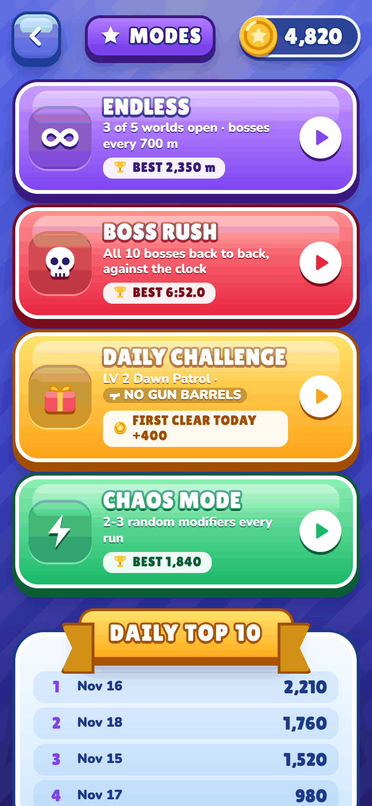
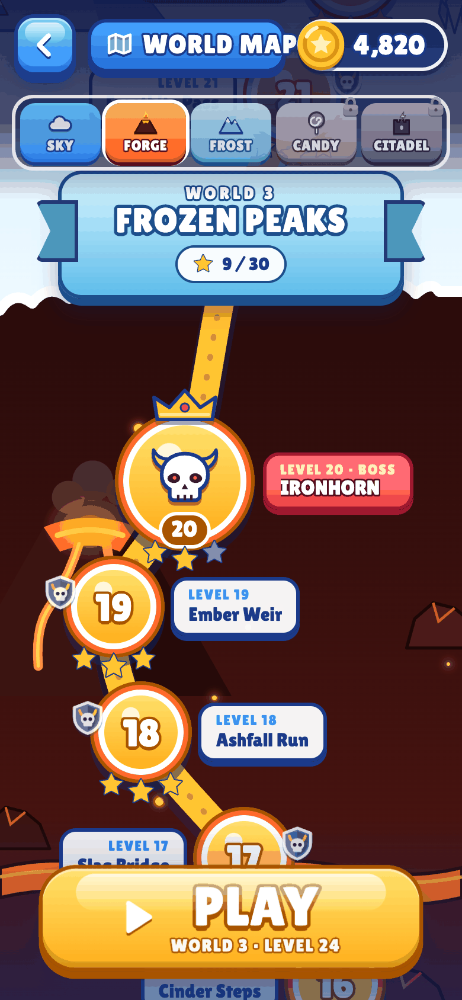
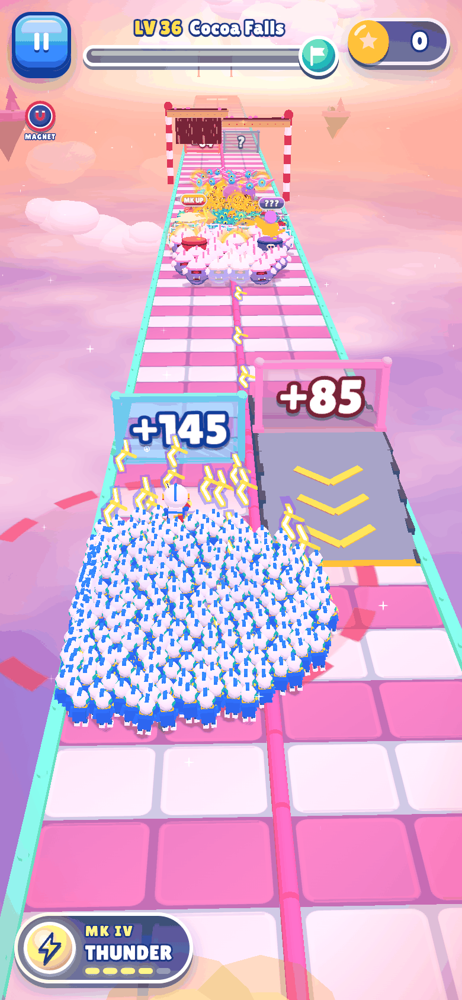
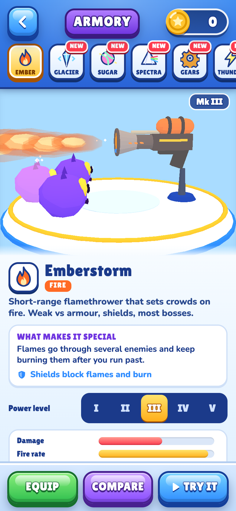
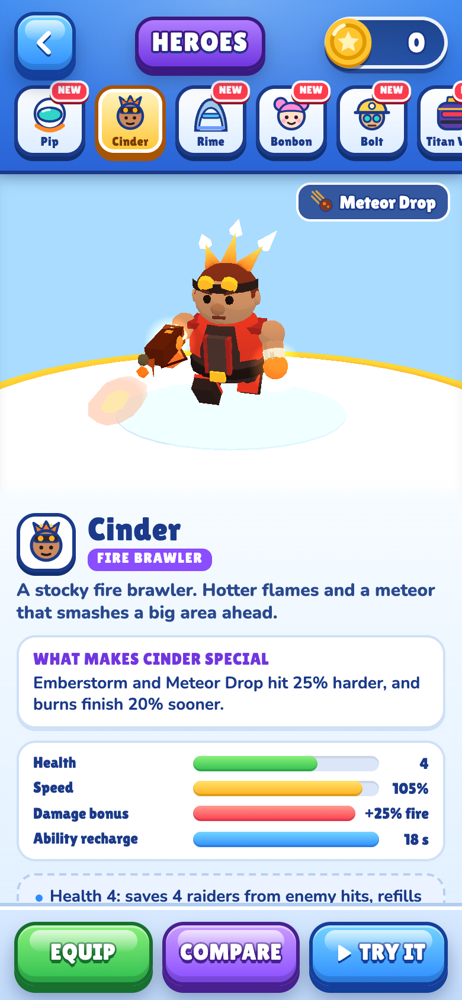

# Nimbus Raiders ⚡ Sky Squad Shooter

A colourful 3D runner-shooter for phone and computer. Lead Pip, or one of five other heroes, and a growing squad of Raiders across five worlds: bridges in the sky, a volcanic forge, frozen peaks, a candy kingdom and a storm citadel. Pick the right gates, break open barrels to power up your weapon, blast through hordes of Murklings, dodge the hazards of each world and take down its bosses.

**▶ Play it now: https://ijokhadze26-bit.github.io/nimbus-raiders/**

It runs in the browser on phone and computer, with nothing to install.


## How to play

- **Move:** drag left and right (finger or mouse), or use the arrow keys / A and D. Your squad shoots by itself.
- **Dodge roll:** swipe up (or press W or the up arrow, or tap the dodge button) to roll. The roll skips the next hit: one enemy touch, blast, hazard or boss strike. It recharges in a few seconds.
- **Hero ability:** tap the round ability button when it is charged (on a keyboard: Space or E). It recharges over time. In Settings you can put the buttons on the left for left-handed play.
- **Formation:** tap the formation button (or press F) to switch between **Line** (wide, +12% damage against the horde), **Wedge** (focused, +20% boss damage) and **Circle** (defensive: shrugs off 25% of enemy touches and blasts, but 10% less damage).
- **Combo:** every kill without losing a Raider adds to your combo. At 25, 60 and 120 it boosts your damage and coins (x1.1, x1.2, x1.3). Losing a Raider resets it.
- **Gates:** blue gates add Raiders, red gates take them away. Some gates multiply (×2, ×3) or divide (÷2, ÷3) your squad. Shooting a + or − gate, or a × / ÷ gate with a progress bar, makes it better, so a bad gate can turn into a good one. Later on you also meet:
  - **3-lane stretches** with three narrow gates,
  - **ramp gates** up on a hump that you run over,
  - **chain gates**, where your pick at the first gate changes what the next ones offer,
  - **hidden "?" gates** behind a group of enemies: shoot through the enemies to see what the gate is.
- **Barrels:** shoot a barrel until its number reaches zero to get its reward: a higher weapon Mk, extra Raiders, a helper drone or a turret. Watch out for purple "???" barrels that flicker into a skull now and then: they are cursed, and shooting one open costs Raiders or a weapon Mk.
- **Rescue cages:** shoot the padlock on a cage to free the Raiders inside. They join your squad when you reach them.
- **Road objects:** shoot a crane's hook to drop its crate on the enemies, shoot a dam's red gate to flood a lane, shoot a bell to stun every enemy for a moment, or run into a boulder from behind to roll it into the horde.
- **Weapons:** pick one of 7 weapons before each level: Emberstorm (fire), Glacier Lance (ice), Sugar Rush (candy), Spectra Prism (light), Gearworks (factory), Thunderclap (storm) and Void Siphon (dark). Each one looks, sounds and fights differently, and climbs from Mk I to Mk V as you break weapon barrels.
- **Weapon crates:** on some levels a glass crate on the road holds a different weapon. Run through it to switch for the rest of the run (the same weapon gives +1 Mk instead).
- **Heroes:** lead your squad as one of 6 heroes, each with a passive bonus and a special ability.
- **Murklings:** crowds of enemies charge at you, often in waves: a first group, a short pause, then a bigger rush. Watch out for fast Dashlings, tough Bulwarks, Shieldbearers and exploding Fizzbombs, and in later worlds Boomlings, Mendlings, Broodling Hives, Spitlings, Flaplings and gold-glowing elites. Enemies also get smarter world by world: they sidestep your shots and sprint when they get close. See **Worlds and Bosses** below.
- **Hazards:** every world has its own: blades and holes in the sky, lava and fire in the forge, ice and avalanches in the peaks, jelly pads and gumballs in the candy kingdom, moving platforms and lightning in the citadel.
- **Power-ups:** a shield bubble, rapid fire, a coin magnet and a freeze.
- **Bosses:** levels 10, 20, 30, 40 and 50 end with a world boss, and each world has a mini-boss halfway (levels 5, 15, 25, 35 and 45); other levels end with a big final rush and a finish line. Red warning stripes and circles show where an attack will land, so step out of the way, and when a world boss shows a glowing safe spot, get the squad into it. There are seven bosses: Grawlstone, Oculon, Ironhorn, Glacius, Gumdrop Goliath, Mother Murk (as the Candy Queen) and the Tempest King.
- **Win** by defeating the boss, or by reaching the finish line, before your squad runs out. You earn up to three stars and some coins.
- **Before each level** the loadout screen shows which weapons the level favours. Choose your hero and weapon, turn on modifiers if you want more coins, then press START.

## Features

- **50 levels in 5 worlds** (Sky Bridge, Volcanic Forge, Frozen Peaks, Candy Kingdom, Storm Citadel) on a **world map**, each with its own look, music, enemy colours, hazards and bosses. A world opens when you beat the boss of the world before it
- **New enemies** in later worlds (Boomling, Mendling, Broodling Hive, Spitling, Flapling) and **elite** enemies with a gold glow and 3x health
- **ELITE mode** for every level you clear with 3 stars: more and tougher enemies, double the level reward and +50% on the coins you pick up
- **Dodge roll, combo meter and squad formations** (Line, Wedge, Circle)
- **3-lane stretches, ramp gates, chain gates** and hidden gates, **rescue cages** and **road objects** (crane, dam, bell, boulder)
- **Game modes** on the MODES screen:
  - **Endless** in every world you have opened, with a boss every 700 m and a saved best distance per world
  - **Boss Rush**: all 10 bosses back to back against the clock, with coins for every boss (opens after you beat level 10)
  - **Daily Challenge**: one level with a twist, the same all day and new every day, with a local top-10 leaderboard and +400 coins for the first clear of the day
  - **Chaos Mode**: a random level with 2-3 random modifiers every run (like x2 speed, tiny squad or only red gates), +25% coins per modifier (opens after you beat level 20)
- **Modifiers** to turn on before a level for extra coins: No Upgrades (+30%), Half Squad (+25%), One Life (+40%) and Fog (+20%)
- 7 weapons and 6 heroes, unlocked by reaching levels or with coins
- An **Armory** and a **Heroes** screen (from the main menu or the loadout screen) with a spinning 3D preview, simple descriptions, stat bars, exact numbers, strong and weak matchups and what changes from Mk I to Mk V. Locked items show as silhouettes with how to unlock them
- **Compare** two weapons or two heroes side by side, and **TRY IT** to test one in a short practice run
- A **shop** with upgrades (starting squad, damage, fire rate, starting weapon level, coin bonus), Pip outfits and gun paint, and a **SQUAD** tab with Raider types that mix into your formation: Shield Bearer (1,500 coins, blocks one enemy hit), Medic (2,500 coins, brings back lost Raiders) and Heavy Gunner (3,500 coins, +3% squad damage each)
- **53 achievements** with coin rewards
- **Settings:** graphics quality (Auto, High, Low), music and sound volume sliders, ability buttons on the left or right, colourblind-friendly gates (blue ▲ for good, orange ▼ stripes for bad) and haptics on phones
- A daily reward, stars, and progress saved on your device
- Generated sound effects and music (a track for every world), with separate mute buttons
- Automatic graphics quality, with a Low setting for older phones

<p align="center">
  
</p>

<!-- u3:begin -->
## Worlds and Bosses

The campaign has 50 levels in 5 worlds. Beat a world's boss to open the next world on the world map. Every world has its own look, music, enemy colours and road hazards, 5 world bosses and 5 mini-bosses. The first level of worlds 2 to 5 is a lesson that shows the new hazards one at a time.

- **Rage:** every boss goes into a rage below 25% health: it glows red and attacks 1.6x as often.
- **Safe spot:** when a world boss changes phase, the whole arena is marked for a big attack except one glowing circle. Move the squad into it; Raiders left outside can be lost (up to 35% of the squad). Mini-bosses skip this step.
- **Red warning stripes and circles** show where any attack will land, always with time to step out of the way.

<p align="center">
  
  
</p>

### 1. Sky Bridge (levels 1-10)

Bridges in the clouds. Learn gates, barrels and the horde.

- **Hazards:**
  - **Spinning blades:** Steel blades whirl on the road (some slide side to side) and cut down Raiders they touch. Steer around them.
  - **Holes:** Gaps in the bridge. Raiders who step over a hole fall in.
- **New enemies:** Murkling, Dashling, Bulwark, Shieldbearer and Fizzbomb
- **Mini-boss, level 5: OCULON**, The Storm Eye. A floating storm eye that throws glowing orbs at target circles and rains orbs on a striped lane. Below 50% health, it adds spiral orb volleys and a laser that sweeps across half of the road. Good weapons: Spectra Prism, Glacier Lance.
- **Boss, level 10: GRAWLSTONE**, The Mossy Colossus. A giant mossy rock that slams its fists down on red circles around the squad. Below 50% health (after a safe-spot step), it slams twice and rolls huge boulders down a striped lane. Good weapons: Spectra Prism, Thunderclap.

### 2. Volcanic Forge (levels 11-20)

Lava rivers, falling embers, cracking tiles and fire geysers.

- **Hazards:**
  - **Lava:** Glowing lava rivers across a lane or the whole road burn up any Raider in them. Stay on the stones.
  - **Falling embers:** Burning rocks fall from the sky onto red warning circles. Dodge the red circles.
  - **Cracked floor:** Cracked tiles start to glow when you step on them and fall away a few seconds later. Get off before it falls.
  - **Fire geysers:** Fire vents in a lane glow, then blast columns of fire on a beat. Pass between the blasts.
  - Level 11 teaches them one at a time.
- **New enemies:** Boomling and Mendling
- **Mini-boss, level 15: MAGMA GRAWLSTONE**, The Lava Colossus. Grawlstone in red-hot lava rock: it slams its fists down on red circles around the squad. Below 50% health, it slams twice and rolls huge boulders down a striped lane. Good weapons: Spectra Prism, Thunderclap.
- **Boss, level 20: IRONHORN**, The Mech Rhino. A mech rhino that charges down one half of the road (it glows red first) and stomps a quake down a lane. In the Volcanic Forge every charge leaves burning lava behind and the stomp rains embers. Below 50% health (after a safe-spot step), it charges twice in a row and fakes a charge, switching sides at the last moment. Good weapons: Gearworks, Thunderclap.

### 3. Frozen Peaks (levels 21-30)

Slippery ice, snowstorms, falling icicles and avalanches.

- **Hazards:**
  - **Ice:** Slippery patches of ice, sometimes across the whole road. Your steering slides.
  - **Snowstorm:** A snowstorm pulls the fog in close. Gates show up late.
  - **Icicles:** Icicles drop where blue shadows grow on the road. Dodge the blue shadows.
  - **Avalanche:** A snow wave from one side shoves the squad sideways; Raiders pushed off the edge fall. Steer against the push.
  - Level 21 teaches them one at a time.
- **New enemies:** Broodling Hive and Spitling
- **Mini-boss, level 25: FROSTHORN**, The Ice Rhino. Ironhorn in ice armour: it charges down one half of the road (it glows red first) and leaves frozen trails that break any Raider standing in them; it stomps a quake down a lane. Below 50% health, it charges twice in a row and fakes a charge, switching sides at the last moment. Good weapons: Gearworks, Thunderclap.
- **Boss, level 30: GLACIUS**, The Frost Giant. A frost giant that freezes a whole lane (step out quickly), throws ice walls that block your bullets, drops icicles and sends frost shocks down the lanes. Below 50% health (after a safe-spot step), more of everything: two frozen lanes and more icicles. Good weapons: Emberstorm, Spectra Prism.

### 4. Candy Kingdom (levels 31-40)

Jelly pads, sticky syrup, rolling gumballs and chocolate falls.

- **Hazards:**
  - **Jelly pad:** A bouncy pad right before a hole launches the whole squad over it. Hit it to bounce over the gap.
  - **Syrup:** Sticky syrup rivers make steering heavy, and slow enemies too. It slows you down.
  - **Gumballs:** Giant gumballs roll down a lane and squash any Raider they roll over. Shoot them or dodge.
  - **Chocolate falls:** Chocolate pours over a lane on a beat; it drowns Raiders and stops bullets. Pass between the pours.
  - Level 31 teaches them one at a time.
- **New enemies:** Flapling and Elite enemies
- **Mini-boss, level 35: GUMDROP GOLIATH**, The Chewy Giant. A huge wobbly gumdrop that jumps up and lands on a red circle, spits out a wave of small gummy Murklings and gobs sticky syrup that slows you down. Below 50% health, it hops twice and spits more. Good weapons: Spectra Prism, Void Siphon.
- **Boss, level 40: CANDY QUEEN**, Ruler of the Sweets. Mother Murk as the Candy Queen: she calls in waves of jelly Murklings, drops sticky syrup puddles and throws candy-cane volleys. Below 50% health (after a safe-spot step), bigger waves, with Fizzbombs and Shieldbearers. Good weapons: Void Siphon, Thunderclap.

### 5. Storm Citadel (levels 41-50)

Moving platforms, lightning, wind gusts and falling bridges.

- **Hazards:**
  - **Moving platform:** A deck slides side to side over a hole across the whole road; Raiders off the deck fall. Stay on it.
  - **Lightning:** Bolts strike the road, each one marked first with a circle. Dodge the purple marks.
  - **Wind:** Gusts push the squad sideways; Raiders blown past the edge fall off. Steer against the gusts.
  - **Falling bridge:** A bridge section shakes, then crumbles from the back, the cracked side faster than the solid side. Take the solid side.
  - Level 41 teaches them one at a time.
- **New enemies:** none, but every enemy is back, faster and smarter
- **Mini-boss, level 45: OCULON**, The Citadel Eye. Oculon in Storm Citadel colours: it throws glowing orbs at target circles and rains orbs on a striped lane. Below 50% health, it adds spiral orb volleys and a laser that sweeps across half of the road. Good weapons: Spectra Prism, Glacier Lance.
- **Boss, level 50: TEMPEST KING**, Lord of the Storm. The final boss, with attacks from every world. Phase 1 is the storm: lightning down the lanes, thunder slams, orb volleys and Murkling waves. Below 66% health (after a safe-spot step), he adds Volcanic Forge ember rain and Frozen Peaks frozen lanes. Below 33% health (after a safe-spot step), he adds a rolling Candy Kingdom gumball and Grawlstone's rock slam, and freezes two lanes at once. Good weapons: Spectra Prism, Void Siphon.

### Enemies

| Enemy | What it does | Tip | First met |
|---|---|---|---|
| **Murkling** | The basic purple Murkling. Weak alone, dangerous in a big crowd. | Keep your squad big: every Raider shoots. | Sky Bridge, level 1 |
| **Dashling** | Small and fast: it rushes ahead of the crowd. | Shoot the front of the horde first. In later worlds they sprint when close. | Sky Bridge, level 2 |
| **Bulwark** | A big armoured brute with 8x a Murkling's health. Slow, but one touch can cost 3 Raiders. | Hit it hard early, or steer around it. | Sky Bridge, level 6 |
| **Shieldbearer** | Its shield soaks up 6 hits before it breaks. From world 3 on it turns the shield to face your fire. | Splash, chains and saw gears get past the shield. | Sky Bridge, level 4 |
| **Fizzbomb** | A red fizzing bomb. If it reaches the squad it explodes and takes up to 4 Raiders with it. | Shoot it early: blown up in the crowd, it takes the Murklings around it instead. | Sky Bridge, level 5 |
| **Boomling** | When it dies it swells up, then bursts: up to 8 Raiders close by are lost, and every enemy close by too. | Kill it while it is far away, ideally in the middle of the horde. | Volcanic Forge, level 11 |
| **Mendling** | Stays at the back and heals the enemies around it (6% of their health every second). | Kill it first. | Volcanic Forge, level 11 |
| **Broodling Hive** | A slow, tough sack (14x a Murkling's health) that keeps popping out small Murklings until it is destroyed. | Focus it down quickly, before its little ones pile up. | Frozen Peaks, level 21 |
| **Spitling** | Stops far ahead and lobs goo at the squad. A marker shows where it lands; up to 2 Raiders under it are lost. | Step out of the green marker, then shoot the Spitling. | Frozen Peaks, level 21 |
| **Flapling** | Flies over gates, holes and hazards, then dives into the squad. | Shoot it as it swoops in; walls and holes do not stop it. | Candy Kingdom, level 31 |
| **Elite enemies** | Elite versions of any enemy glow gold, are a bit bigger and have 3x the health. | Save your hero ability for a crowd of glowing elites. | Candy Kingdom, level 31 |

<!-- u3:end -->

<!-- u2:begin -->
## Weapons & Heroes

Pick a hero and a weapon before every level. Every weapon has its own look, sound, bullets and special trick, and five power levels, Mk I to Mk V: breaking weapon barrels during a run raises it, and every level looks bigger and flashier. Strong and weak matchups matter, and some levels and bosses favour certain weapons.

<p align="center">
  
  
</p>

### Weapons

| Weapon | Type | What it does | Strong against | Weak against | How to get it |
|---|---|---|---|---|---|
| **Emberstorm** | FIRE | Short-range flamethrower that sets crowds on fire. Weak vs armour, shields, most bosses. Flames go through several enemies and keep burning them after you run past. | Murkling, Fizzbomb | Bulwark, Shieldbearer, Oculon, Ironhorn, Tempest King | Reach level 5, or buy for 900 coins |
| **Glacier Lance** | ICE | Ice shards pierce a line of enemies, slow them and sometimes freeze them solid. Every shard goes through several enemies. Frozen enemies shatter when you touch them. | Dashling, Oculon | Fizzbomb, Ironhorn | Reach level 3, or buy for 500 coins |
| **Sugar Rush** | CANDY | Bouncy candy bombs splash crowds and leave sticky caramel. Weak against most bosses. Splash hits right over shields. Caramel puddles slow everything that steps in. | Shieldbearer | Dashling, Oculon, Ironhorn, Tempest King | Reach level 9, or buy for 1,800 coins |
| **Spectra Prism** | LIGHT | Rainbow beam that splits into extra beams on a hit. The best boss killer. Highest damage on one target. Each hit splits into small beams that find nearby enemies. | Bulwark, Grawlstone, Oculon, Mother Murk, Ironhorn, Tempest King | Murkling | Reach level 11, or buy for 2,500 coins |
| **Gearworks** | FACTORY | Spinning saw gears bounce between enemies, and it drops mini turrets on the road. Best against armour: gears shred Bulwarks and break 3 shield hits each. | Bulwark, Shieldbearer, Ironhorn | Dashling, Oculon | Reach level 7, or buy for 1,300 coins |
| **Thunderclap** | STORM | Lightning bolts that chain from enemy to enemy. A good all-rounder. Every hit jumps to more enemies nearby, a bit weaker each jump. | Fizzbomb, Ironhorn | Tempest King | Free from the start |
| **Void Siphon** | DARK | Slow orbs that open small black holes, pulling enemies together and crushing them. Black holes pack crowds together. Pairs with Sugar Rush, Meteor Drop and Fizzbombs. | Dashling, Shieldbearer, Mother Murk, Tempest King | Bulwark, Ironhorn | Reach level 13, or buy for 3,200 coins |

### Heroes

| Hero | What they do | Passive bonus | Special ability | Health and dodge | Favourite weapon | Strong against | Weak against | How to get them |
|---|---|---|---|---|---|---|---|---|
| **Pip**, Sky Scout | A cheerful all-rounder. Steady aim and a whistle that calls in extra raiders. | **Steady Aim:** +10% fire rate with every weapon. | **Rally Call:** Instantly adds 20% more raiders (at least 5, at most 40) and refills Guard. Recharges in 20 s. | Health 3 (saves 3 raiders from enemy hits). Dodge speed 100% (normal side to side speed). | Thunderclap | Murkling, Dashling | Tempest King | Free from the start |
| **Cinder**, Fire Brawler | A stocky fire brawler. Hotter flames and a meteor that smashes a big area ahead. | **Hot Hands:** Emberstorm and Meteor Drop deal +25% damage; every burn finishes 20% sooner. | **Meteor Drop:** A flaming rock smashes a 5 m circle ahead, then the ground burns. Recharges in 18 s. | Health 4 (saves 4 raiders from enemy hits). Dodge speed 105% (moves side to side faster). | Emberstorm | Murkling, Fizzbomb | Shieldbearer, Oculon | Reach level 4, or buy for 700 coins |
| **Rime**, Ice Sniper | A calm ice sniper. Shoots further, pierces more, and can freeze the whole screen. | **Long Sight:** +20% range for every weapon; +1 pierce for Glacier Lance, Emberstorm and Spectra Prism. | **Whiteout:** Freezes every enemy on screen for 4 s. Frozen enemies take +25% damage; the boss stops attacking. Recharges in 30 s. | Health 2 (saves 2 raiders from enemy hits). Dodge speed 90% (moves side to side slower). | Glacier Lance | Murkling, Shieldbearer, Oculon | Fizzbomb | Reach level 6, or buy for 1,100 coins |
| **Bonbon**, Candy Trickster | A bouncy candy trickster. Earns extra coins and wraps the squad in a sugar shield. | **Sweet Tooth:** +25% coins from every run (wins, losses and endless). | **Sugar Shield:** The squad is invincible for 5 s. Enemies that touch it pop. Recharges in 26 s. | Health 2 (saves 2 raiders from enemy hits). Dodge speed 115% (moves side to side faster). | Sugar Rush | Mother Murk | Bulwark | Reach level 8, or buy for 1,500 coins |
| **Bolt**, Engineer | A handy engineer. Turrets last longer, fire faster, and a big fortress drops in. | **Overclock:** Road turrets and the Fortress last 60% longer; every turret fires 25% faster. | **Deploy Fortress:** Drops a big turret that rides with the squad for 12 s, firing piercing shells. Recharges in 20 s. | Health 3 (saves 3 raiders from enemy hits). Dodge speed 95% (moves side to side slower). | Gearworks | Fizzbomb, Ironhorn | Dashling | Reach level 10, or buy for 2,000 coins |
| **Titan Vex**, Heavy Guard | A huge armoured guard. Starts with a bigger squad, but dodges side to side slower. | **Big Squad:** +6 raiders at the start of every level and endless run. | **Shockwave:** A shield slam knocks the whole horde back up to 18 m and stuns it. Recharges in 22 s. | Health 6 (saves 6 raiders from enemy hits). Dodge speed 70% (moves side to side slower). | Void Siphon | Bulwark, Fizzbomb | Murkling, Oculon | Reach level 12, or buy for 2,800 coins |

Every hero does 15% more damage with their favourite weapon. Health is Guard: each point saves one raider from an enemy touch or a Fizzbomb blast, and one point comes back every 4 s. Speed is how fast the hero dodges side to side; the run speed is the same for everyone, so gates and barrels stay fair.

<!-- u2:end -->

## Run it on your own computer

You need [Node.js](https://nodejs.org) 20.19+ or 22.12+ (the current LTS version is fine).

```bash
npm install
npm run dev
```

Then open the address it prints, usually http://localhost:5173. Phones on the same Wi-Fi can use the "Network" address it shows.

To make the files for a website, run `npm run build`. The finished game is in the `dist` folder.

## Made with

[Three.js](https://threejs.org) for the 3D graphics, [Vite](https://vite.dev) for building, and plain JavaScript. Every pushed change to `main` is published to GitHub Pages automatically by `.github/workflows/deploy.yml`.

Nimbus Raiders and all of its characters are original creations.
