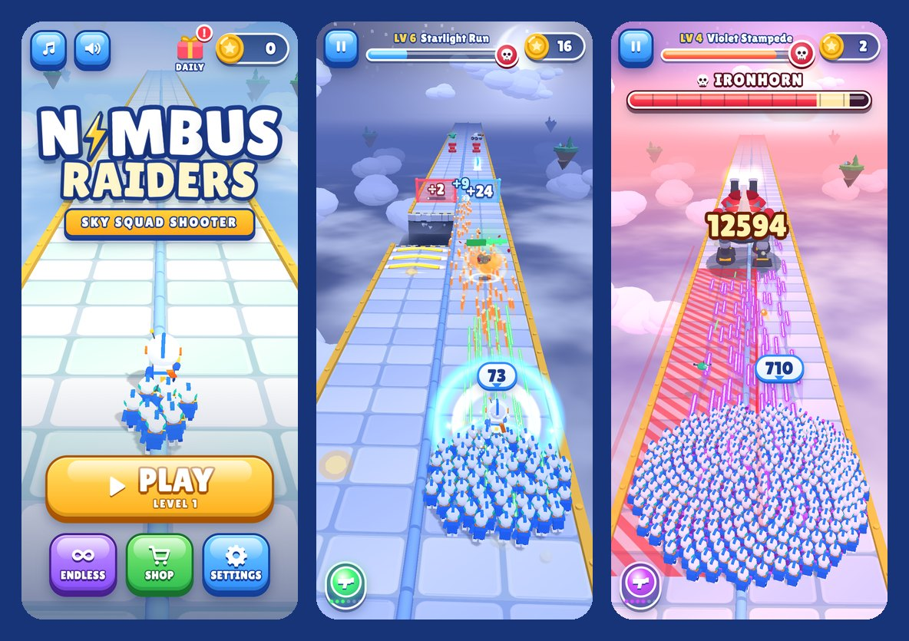

# Nimbus Raiders ⚡ Sky Squad Shooter

A colourful 3D runner-shooter for phone and computer. Lead Pip and a growing squad of Raiders along a bridge in the sky. Pick the right gates, break open barrels for better guns, blast through hordes of Murklings and take down a giant boss at the end of every level.

**▶ Play it now: https://ijokhadze26-bit.github.io/nimbus-raiders/**

It runs in the browser on phone and computer, with nothing to install.



## How to play

- **Move:** drag left and right (finger or mouse), or use the arrow keys / A and D. Your squad shoots by itself.
- **Gates:** blue gates add Raiders, red gates take them away. Some gates multiply (×2, ×3) or divide (÷2, ÷3) your squad. Shooting a + or − gate, or a × / ÷ gate with a progress bar, makes it better, so a bad gate can turn into a good one.
- **Barrels:** shoot a barrel until its number reaches zero to get its reward: a better gun, extra Raiders, a helper drone or a turret.
- **Guns:** your weapon climbs through tiers, from a blaster pistol to a rifle, a green laser, a pink beam and beyond.
- **Murklings:** crowds of purple enemies charge at you. Watch out for fast Dashlings, tough Bulwarks, Shieldbearers and exploding Fizzbombs.
- **Hazards:** dodge spinning blades and holes in the road. Raiders who step over a hole fall in.
- **Power-ups:** a shield bubble, rapid fire, a coin magnet and a freeze.
- **Bosses:** every level ends with a boss. Red warning stripes show where an attack will land, so step out of the way. There are five bosses: Grawlstone, Oculon, Mother Murk, Ironhorn and the Tempest King.
- **Win** by defeating the boss before your squad runs out. You earn up to three stars and some coins.

## Features

- 15 levels on a sky map, plus **Endless mode** with a saved best distance
- A **shop** with upgrades (starting squad, damage, fire rate, starting gun, coin bonus) and outfits for Pip and the guns
- A daily reward, stars, and progress saved on your device
- Generated sound effects and music, with separate mute buttons
- Automatic graphics quality, with a Low setting for older phones

## Run it on your own computer

You need [Node.js](https://nodejs.org) 20.19+ or 22.12+ (the current LTS version is fine).

```bash
npm install
npm run dev
```

Then open the address it prints, usually http://localhost:5173. Phones on the same Wi-Fi can use the "Network" address it shows.

To make the files for a website, run `npm run build`. The finished game is in the `dist` folder.

## Made with

[Three.js](https://threejs.org) for the 3D graphics, [Vite](https://vite.dev) for building, and plain JavaScript. Every pushed change to `main` is published to GitHub Pages automatically by `.github/workflows/deploy.yml`.

Nimbus Raiders and all of its characters are original creations.
